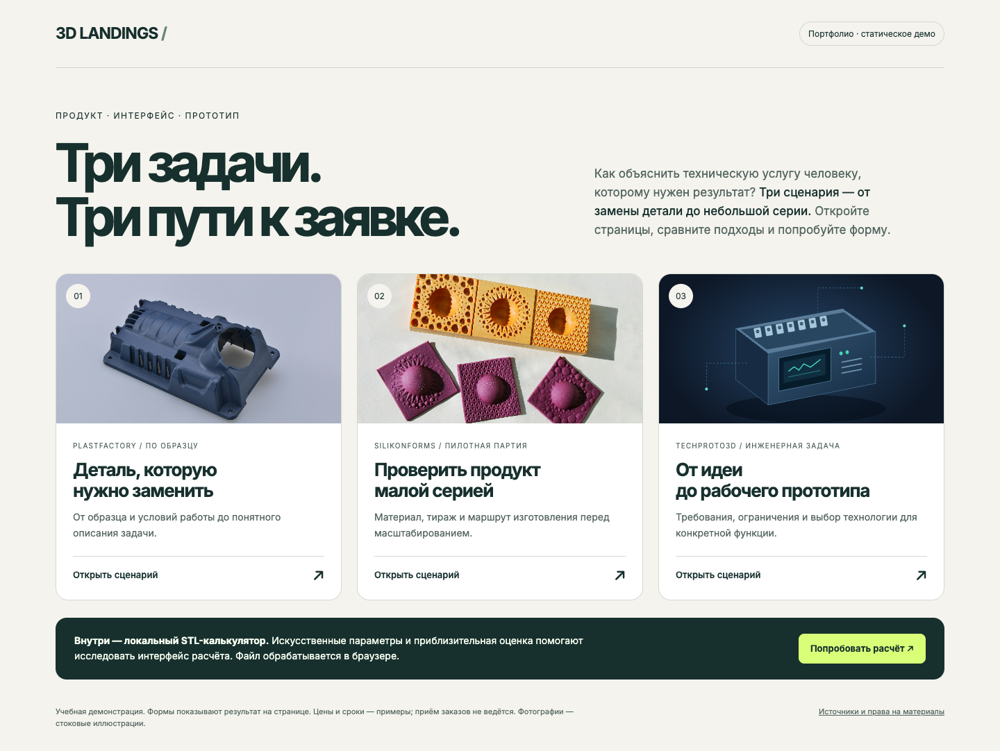

# 3D Landings · Showcase

[English](README.en.md)

Три демосайта помогают заказчику объяснить, что нужно изготовить. Для замены сломанной детали, пробной партии и прототипа предусмотрены разные страницы. В одном из сценариев можно загрузить STL-модель и получить предварительный расчёт прямо в браузере.



## Назначение

| Страница | Сценарий |
|---|---|
| [PlastFactory](sites/plastfactory/index.html) | Деталь по образцу: от проблемы с заменой до описания задачи |
| [SilikonForms](sites/silikonforms/index.html) | Пилотная серия: выбор маршрута и предварительная оценка |
| [TechProto3D](sites/techproto3d/index.html) | Функциональный прототип: требования, материалы и ограничения |

Это сохранённый эксперимент по упаковке технического продукта: структура предложения, разные пути к заявке, мобильная навигация и вычисления на стороне браузера. Коммерческие формулировки, цены и сроки внутри страниц служат примерами интерфейса; они не являются действующим предложением или подтверждением производственных возможностей.

## Работа с проектом

Нужны Python 3 и современный браузер. Сборщика, npm-пакетов и backend нет:

```sh
python3 -m http.server 8000 --bind 127.0.0.1
```

Откройте [http://127.0.0.1:8000](http://127.0.0.1:8000). Корневая страница ведёт ко всем трём сценариям и калькулятору. Ссылки на HTML в GitHub показывают исходники; интерактивное демо запускается локально.

Форма показывает текст заявки на той же странице. Она не отправляет сообщения, не открывает мессенджер и не записывает ввод в хранилище. Используйте вымышленные данные. Калькулятор читает выбранный STL в браузере и даёт приблизительную оценку на демонстрационных параметрах; проверка пригодности модели к производству и коммерческий расчёт требуют отдельной работы.

Для запуска синтетических тестов калькулятора дополнительно нужен Node.js:

```sh
node tests/calculator.test.cjs
```

Тесты проверяют геометрию STL, пределы входных данных, расчёт, обработку имени файла и запоздалое чтение. Они используют стандартную библиотеку и не требуют npm-install. Дополнительно страницы проверены в Chrome при ширине 1440 и 390 пикселей, с включённым и отключённым JavaScript. Это проверка демонстрации, не производственная валидация.

## Карта материалов

- [`index.html`](index.html) — вход в демонстрацию.
- [`sites/`](sites/) — три самостоятельные статические страницы с локальными ресурсами.
- [`sites/silikonforms/calc/`](sites/silikonforms/calc/) — экспериментальный STL-калькулятор.
- [`tests/calculator.test.cjs`](tests/calculator.test.cjs) — воспроизводимые проверки на искусственных данных.
- [`THIRD_PARTY_NOTICES.md`](THIRD_PARTY_NOTICES.md) и [`docs/asset-sources.json`](docs/asset-sources.json) — происхождение фотографий и шрифтов.
- [`SECURITY.md`](SECURITY.md) — границы публичной копии и правила для примеров ошибок.

В этой версии нет старой истории разработки, инфраструктуры, настроек развёртывания, коммерческих предложений и рабочих контактов. Это самостоятельный снимок для изучения, без подключения к прежним сервисам.

Авторский код, текст и новые SVG-схемы — [MIT](LICENSE). Стоковые фотографии остаются под условиями Unsplash/Pexels, шрифты — под OFL-1.1. Фотографии иллюстрируют тему и не изображают заявленное собственное производство. Подробности — в [уведомлениях о правах](THIRD_PARTY_NOTICES.md).
